<div align="center">

# Fırtına ve Yörünge · Storm & Orbit

**Güneş fırtınaları alçak yörüngedeki uyduları nasıl alçaltıyor?**

60 yıllık uydu kataloğu, 94 yıllık uzay havası kaydı ve 64 fırtınada 10.695 yörünge ölçümüyle bir veri bilimi projesi ve etkileşimli 3B sunumu.

[**Canlı sunum**](https://storm-and-orbit.up.railway.app) · [Sonuçlar](docs/SONUCLAR.md) · [Yöntem](docs/YONTEM.md) · [Veri](docs/VERI.md) · [Sunum](docs/SUNUM.md) · [Geçmiş](docs/GECMIS.md) · [English summary](#english-summary)

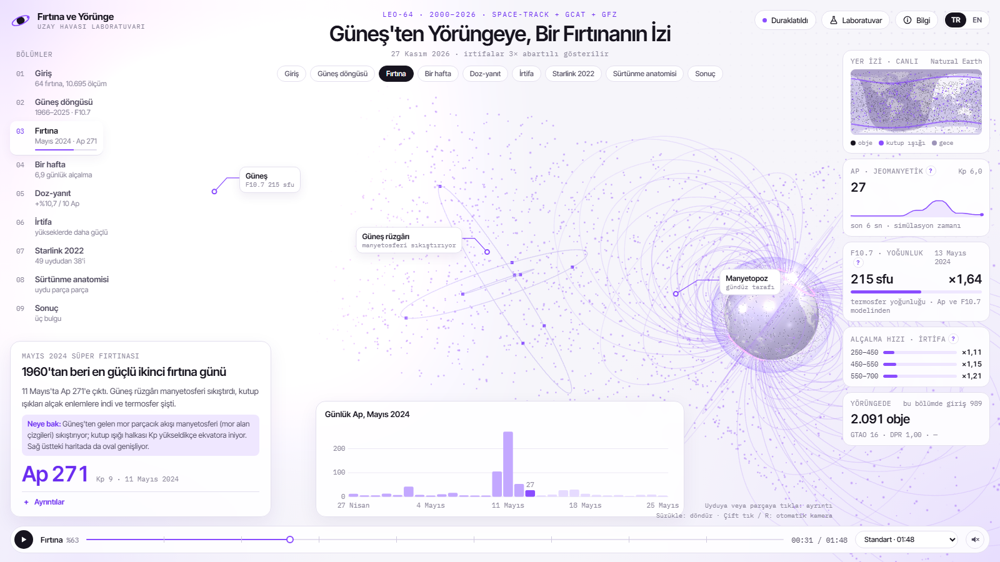

</div>

---

## İçindekiler

- [Özet](#özet)
- [Bulgular](#bulgular)
- [Tanıtım videosu](#tanıtım-videosu)
- [Etkileşimli sunum](#etkileşimli-sunum)
- [Nasıl çalışıyor](#nasıl-çalışıyor)
- [Depo yapısı](#depo-yapısı)
- [Hızlı başlangıç](#hızlı-başlangıç)
- [Analizi baştan üretmek](#analizi-baştan-üretmek)
- [Veri](#veri)
- [Yöntem](#yöntem)
- [Sınırlar](#sınırlar)
- [Yayın](#yayın)
- [Araçlar](#araçlar)
- [Proje geçmişi](#proje-geçmişi)
- [Kaynaklar ve atıf](#kaynaklar-ve-atıf)
- [Lisans](#lisans)
- [English summary](#english-summary)

---

## Özet

Güneş patlamaları Dünya'nın üst atmosferini (termosfer) ısıtıp genişletir. Alçak Dünya yörüngesindeki (LEO) uydular daha yoğun havadan geçer, sürtünme artar ve yörüngeleri alçalır. Bu proje, etkinin büyüklüğünü üç zaman ölçeğinde ölçüyor:

| Ölçek | Soru | Veri |
|---|---|---|
| **Yıllar** | Güneş döngüsü yörüngedeki objelerin düşme hızını değiştiriyor mu? | 35.231 kontrolsüz yeniden giriş; yıllık oranlar 1966–2025 |
| **Günler** | Büyük bir fırtınadan sonra daha çok obje düşüyor mu? | 54 fırtına (Ap ≥ 100), rastgele tarih testi |
| **Haftalar** | Fırtına haftasında yörüngeler ne kadar alçalıyor? | 64 fırtına, 10.695 obje-fırtına ölçümü, plasebo haftaları |

Ek olarak 407 Starlink fırlatmasında ilk haftadaki fırtınaların erken kayıplarla ilişkisi incelendi.

Bütün veriler herkese açık: [GCAT](https://planet4589.org/space/gcat/) uydu kataloğu, [GFZ Potsdam](https://kp.gfz-potsdam.de/en/) jeomanyetik indeksleri ve [Space-Track.org](https://www.space-track.org/) yörünge geçmişi.

---

## Bulgular

### 1 · Güneş maksimumunda yörünge 3,5 kat hızlı boşalıyor

Kontrolsüz objelerin (enkaz, roket gövdesi) yıllık düşme oranı, Güneş aktivitesiyle (F10.7) birlikte yükselip alçalıyor. Maksimumda (F10.7 ≈ 190 sfu) oran, minimumdakinin (≈ 73 sfu) **3,52 katı**. Spearman r = 0,78; Pearson r = 0,67.

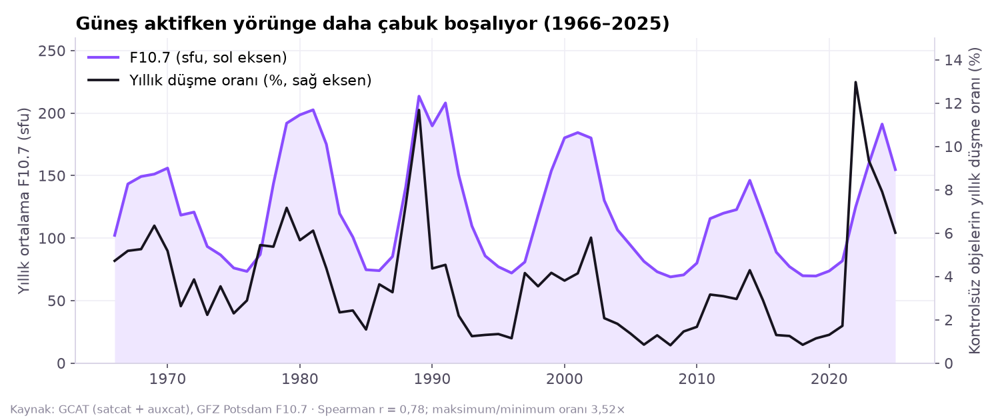

### 2 · Tek fırtına düşen sayısını belirgin artırmıyor

Ap ≥ 100 olan 54 fırtınadan sonraki 14 günde **+%11,7** fazla obje düştü, ama %95 aralık −%2,1 ile +%27,2 arasında ve **p = 0,082**: yön tutarlı, sonuç kesin değil. Karşılaştırma, aynı Güneş aktivitesindeki sakin rastgele günlerle (2.000 tekrar) yapıldı.

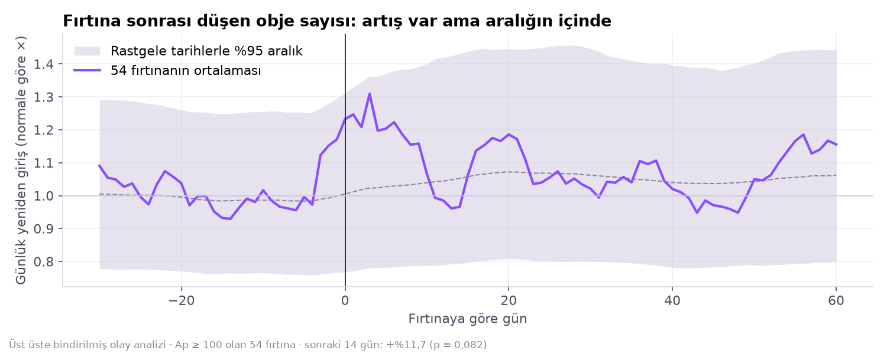

### 3 · Ama fırtına yörüngeleri ölçülebilir biçimde alçaltıyor

Fırtına haftasında objeler normal hızlarının ortanca **1,30 katı** alçaldı; fırtınasız plasebo haftalarında **0,95 katı**. 64 fırtınanın **49'unda** fırtına haftası plasebodan hızlıydı (Wilcoxon p = 1,1·10⁻⁵).

**Doz-yanıt:** haftalık ortalama Ap'deki her **+10** artış alçalmayı **%10,7** hızlandırıyor (%95: 7,7–15,0). F10.7'deki her +10 sfu ayrıca %6,4 ekliyor.

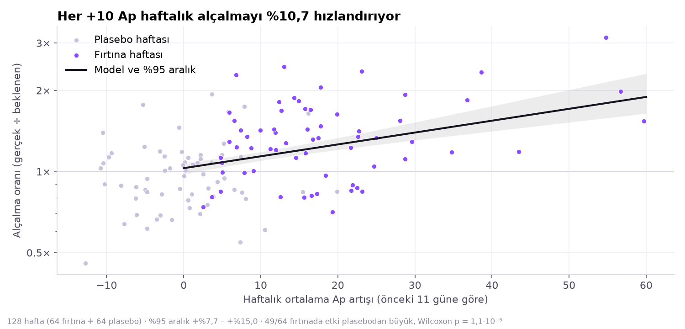

### 4 · Etki yükseldikçe büyüyor

| İrtifa | +10 Ap başına | %95 aralık |
|---|---|---|
| 250–450 km | +%6,6 | 3,9 – 10,6 |
| 450–550 km | +%9,5 | 6,8 – 13,1 |
| 550–700 km | **+%12,7** | 9,4 – 17,8 |

Seyrek üst katmanlar fırtınada oransal olarak daha çok şişiyor; bu, bilinen termosfer fiziğiyle uyumlu bağımsız bir doğrulama.

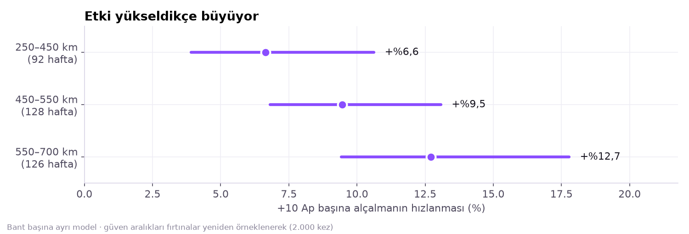

### 5 · En büyük kayıp: Cadılar Bayramı 2003

| Fırtına | Ap tepe | Ortanca obje bir haftada |
|---|---|---|
| Cadılar Bayramı 2003 | 204 | **15,0 günlük** normal alçalma |
| Mayıs 2024 | 271 | 6,9 günlük |
| Temmuz 2004 | 186 | 1,3 günlük |

Mayıs 2024, 1960'tan beri en güçlü ikinci fırtına günü olsa da en büyük yörünge kaybı 2003'te: o hafta Güneş ışınımı da çok yükselmişti. Temmuz 2004 yüksek Ap'ye rağmen zayıf ışınımla küçük bir etki bıraktı.

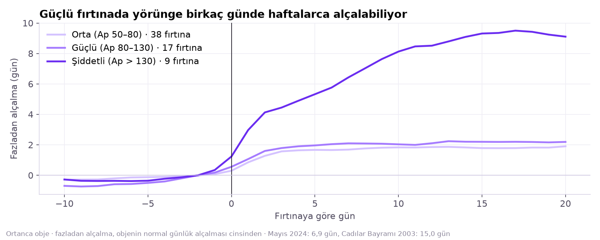

### 6 · Starlink: tehlike fırlatmadan hemen sonra, ama tek bir olay

Alçak (< 250 km) bırakılıp ilk haftası fırtınalı geçen fırlatmalarda 30 günlük kayıp **%3,83**, sakin geçenlerde **%0,60** (Fisher p = 5,6·10⁻⁸). Ancak 42 kaybın 38'i tek fırlatmadan geliyor: **Şubat 2022**, 209 km'de bırakılan 49 uydudan 38'i, küçük ölçekli (G1) bir fırtınada. O fırlatma çıkarılınca fark kayboluyor (%0,38).

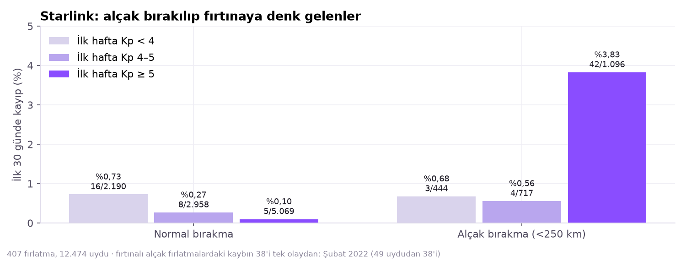

### Bütün tablo

> Güneş döngüsü yörüngedeki nüfusu yıllar ölçeğinde güçlü biçimde düzenliyor. Tek bir fırtına yörüngeleri ölçülebilir biçimde alçaltıyor, ama düşüşü yalnızca birkaç gün ya da hafta öne çektiği için yeniden giriş sayılarında kesin bir iz bırakmıyor. En savunmasız an, fırlatmadan hemen sonraki alçak yörünge.

Bütün tablolar ve 64 fırtınanın listesi: [docs/SONUCLAR.md](docs/SONUCLAR.md)

---

## Tanıtım videosu

[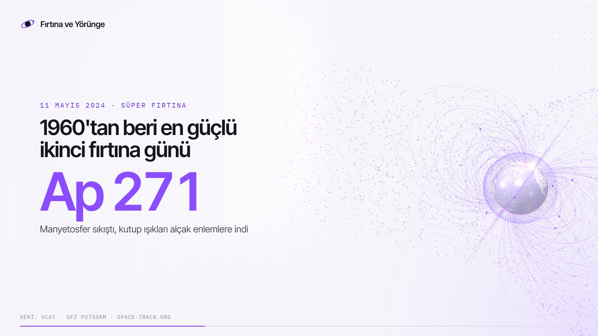](video/storm-and-orbit.mp4)

**[storm-and-orbit.mp4](video/storm-and-orbit.mp4)** · 38 saniye · 1080p · müzikli

Sunumun three.js sahneleri başsız tarayıcıda kare kare çizilip ffmpeg ile MP4'e dönüştürüldü; müzik de tarayıcıda kodla sentezlendi. Nasıl üretildiği ve yeniden üretme adımları: [video/README.md](video/README.md)

---

## Etkileşimli sunum

**https://storm-and-orbit.up.railway.app**

Tarayıcıda çalışan, Türkçe ve İngilizce bir 3B sunum. Bütün sayılar analiz çıktılarından hesaplanır.

| | |
|---|---|
| 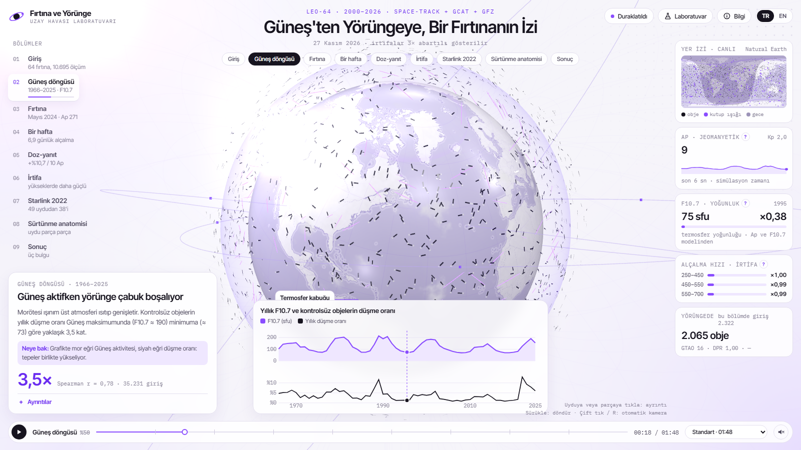 | 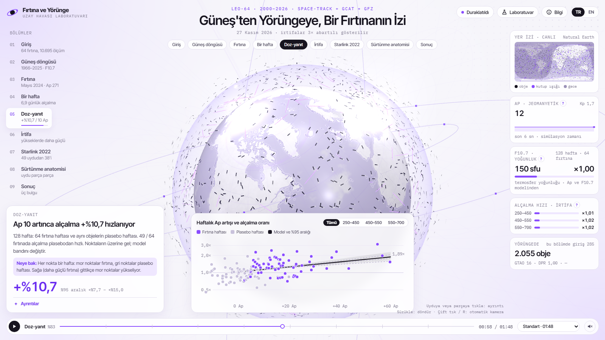 |
| 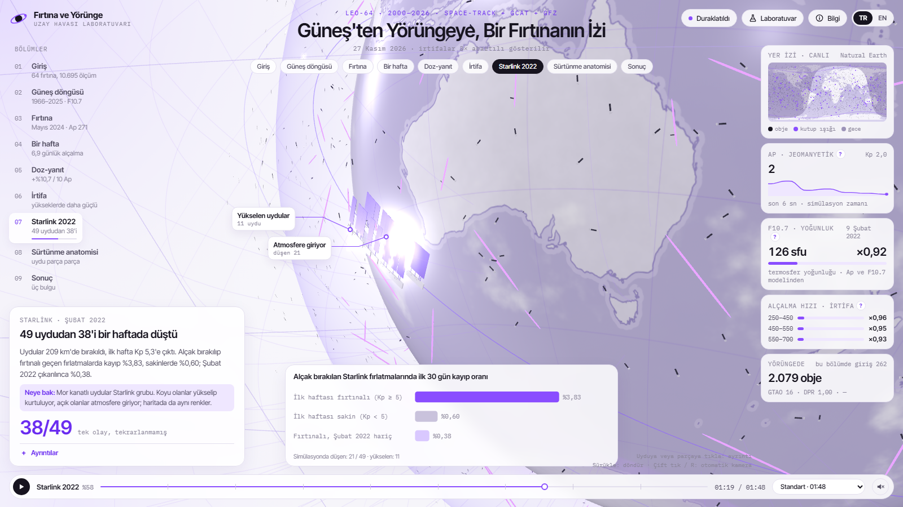 | 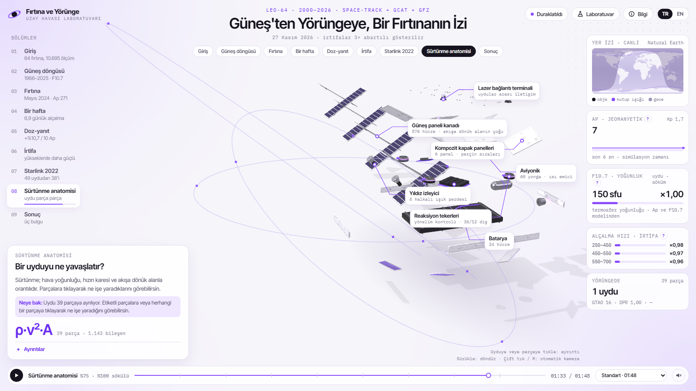 |
| 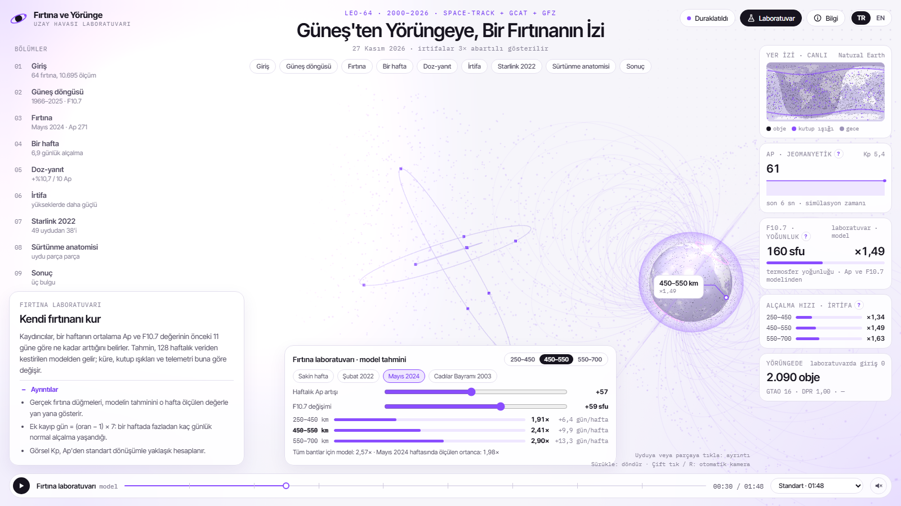 | 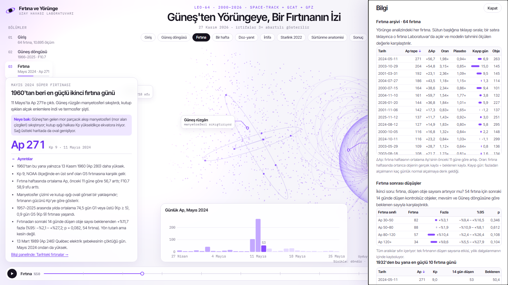 |

**Özellikler**

- **9 bölüm:** giriş, Güneş döngüsü, Mayıs 2024 fırtınası, bir objenin fırtına haftası, doz-yanıt, irtifa, Starlink 2022, uydunun 39 parçaya ayrıldığı sürtünme anatomisi, sonuç.
- **Gerçekçi Dünya:** Natural Earth kıyı çizgileri ve sınırlar, bulutlar, termosfer kabuğu, manyetosfer alan çizgileri, Kp'ye göre genişleyen kutup ışıkları, 2.400 temsilî obje.
- **Beş süre seçeneği:** 01:12'den 05:24'e; her bölüm sonunda duran elle mod.
- **Fırtına laboratuvarı:** Ap ve F10.7 kaydırıcılarıyla kendi fırtınanı kur; model üç irtifa bandı için tahmin verir, gerçek fırtınalarla karşılaştırır.
- **Tıklayarak inceleme:** küredeki objelerin irtifası, eğimi, periyodu ve konumu; uydu parçalarının ne işe yaradığı.
- **Bilgi paneli:** terimler, 64 fırtınanın sıralanabilir arşivi, fizik, NOAA ölçeği, tarihteki büyük fırtınalar, sık sorulanlar.
- **Canlı telemetri:** yer izi haritası, Ap/Kp grafiği, yoğunluk çarpanı, bant bant alçalma hızı.
- **Sentezlenmiş müzik:** ses dosyası yok; re minörde, bölüme göre düzenlenen ve doz-yanıt verisini notaya çeviren bir müzik motoru.
- **Erişilebilir:** klavye kısayolları, odak halkaları, ekran okuyucu desteği, azaltılmış hareket tercihi, mobil düzen.

Ayrıntılar, mimari ve bütün ekran görüntüleri: [docs/SUNUM.md](docs/SUNUM.md)

---

## Nasıl çalışıyor

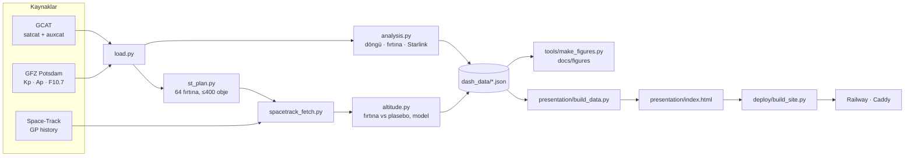

1. **Okuma ve temizlik** (`load.py`): iki GCAT kataloğu birleştirilir, tarihler ayrıştırılır, obje türleri ayrılır; GFZ dosyasından günlük indeksler okunur.
2. **Katalog analizleri** (`analysis.py`): yıllık düşme oranı, üst üste bindirilmiş olay analizi ve Starlink fırlatmaları.
3. **Yörünge analizi** (`st_plan.py` → `spacetrack_fetch.py` → `altitude.py`): fırtına seçimi, yörünge geçmişi indirme, obje başına fırtına ve plasebo ölçümü, hafta düzeyinde model.
4. **Çıktı:** her biri kendini üreten kodu da taşıyan `dash_data/*.json` dosyaları.
5. **Sunum ve grafikler:** aynı dosyalardan.

---

## Depo yapısı

```
storm-and-orbit/
├── load.py                  Ham verileri okuma ve temizleme
├── analysis.py              A) Güneş döngüsü  B) fırtına sonrası düşüş  C) Starlink
├── st_plan.py               Yörünge analizi için fırtına ve obje seçimi
├── spacetrack_fetch.py      Space-Track yörünge geçmişini indirme
├── altitude.py              D) Fırtına haftasında yörünge alçalması
├── download_data.py         GCAT ve GFZ verilerini güncel hâliyle indirme
├── requirements.txt
├── results.json             analysis.py tam çıktısı
├── results_alt.json         altitude.py tam çıktısı
├── data/
│   ├── satcat.tsv, auxcat.tsv, ftocat.tsv   GCAT anlık görüntüsü (26 Kasım 2026)
│   ├── kp.txt                               GFZ Kp/Ap/F10.7 (1932–2026)
│   ├── st_plan.json                         64 fırtına penceresi ve obje listeleri
│   └── spacetrack/                          (depoda yok; Space-Track koşulları)
├── dash_data/               13 özet dosyası (her biri kodunu da taşır)
├── presentation/
│   ├── template.html        Sunumun kaynağı (CSS + HTML + JS)
│   ├── build_data.py        Veriyi sunuma gömer
│   ├── index.html           Derlenmiş sunum
│   └── geo/                 Natural Earth TopoJSON
├── deploy/                  Railway yayını (Dockerfile, Caddyfile, site/)
├── page/                    İlk analiz raporunun pano sayfası
├── video/                   Tanıtım videosu (MP4) ve onu üreten betikler
├── tools/
│   ├── make_figures.py      docs/figures grafiklerini üretir
│   └── screenshots/         Sunumdan ekran görüntüsü alan Node betiği
└── docs/
    ├── SONUCLAR.md          Bütün sonuçlar, tablolar, grafikler
    ├── YONTEM.md            Adım adım yöntem
    ├── VERI.md              Veri kaynakları ve dosya alanları
    ├── SUNUM.md             Sunumun özellikleri ve mimarisi
    ├── GECMIS.md            Proje geçmişi ve kararlar
    ├── figures/             6 sonuç grafiği
    └── screenshots/         17 sunum ekran görüntüsü
```

---

## Hızlı başlangıç

Gereken: Python 3.11+ (Node yalnızca ekran görüntüsü aracı için).

```powershell
git clone https://github.com/CodeByPinar/storm-and-orbit.git
```

```powershell
cd storm-and-orbit
```

```powershell
python -m pip install -r requirements.txt
```

**Sunumu yerelde açmak:**

```powershell
python presentation\build_data.py
```

```powershell
python -m http.server 8791 --directory presentation
```

Ardından tarayıcıda `http://localhost:8791/preview.html`.

**Grafikleri yeniden üretmek:**

```powershell
python tools\make_figures.py
```

---

## Analizi baştan üretmek

### Katalog analizleri (hesap gerekmez)

Depodaki veri anlık görüntüsüyle ya da güncel veriyle:

```powershell
python download_data.py
```

```powershell
python analysis.py
```

Yaklaşık 40 saniye sürer; `results.json` ve `dash_data/` güncellenir.

### Yörünge analizi (Space-Track hesabı gerekir)

1. [space-track.org](https://www.space-track.org/auth/createAccount) adresinden ücretsiz hesap açın.
2. Fırtınaları ve objeleri seçin:

```powershell
python st_plan.py
```

3. Yörünge geçmişini indirin. Kullanıcı adı ve şifre terminalde sorulur (ya da `SPACETRACK_USER` / `SPACETRACK_PASS` ortam değişkenlerinden okunur) ve hiçbir dosyaya yazılmaz. Hız sınırına uyarak 5–10 dakika sürer; yarıda kalırsa kaldığı yerden devam eder.

```powershell
python spacetrack_fetch.py
```

4. Analizi çalıştırın:

```powershell
python altitude.py
```

---

## Veri

| Kaynak | İçerik | Lisans | Depoda |
|---|---|---|---|
| [GCAT](https://planet4589.org/space/gcat/) (J. McDowell) | Bütün yapay uzay objeleri: fırlatma, düşüş, tür, yörünge | CC BY 4.0 | Anlık görüntü |
| [GFZ Potsdam](https://kp.gfz-potsdam.de/en/) | 1932'den bu yana Kp, Ap, F10.7, Güneş lekesi | CC BY 4.0 | Anlık görüntü |
| [Space-Track.org](https://www.space-track.org/) | Tarihsel yörünge kayıtları (GP history) | Kullanım koşulları | **Hayır**, yalnızca özetler |
| [Natural Earth](https://www.naturalearthdata.com/) | Kara ve ülke sınırları (sunum haritası) | Kamu malı | Evet |

Dosya dosya alanlar ve şemalar: [docs/VERI.md](docs/VERI.md)

---

## Yöntem

Kısa hâli; her adımın ayrıntısı [docs/YONTEM.md](docs/YONTEM.md) içinde.

**Güneş döngüsü.** Her yıl 1 Ocak'ta yörüngede olan kontrolsüz alçak yörünge objelerinin o yıl düşen oranı; yıllık ortalama F10.7 ile korelasyon ve regresyon.

**Fırtına sonrası düşüş.** Ap ≥ 100 olan, birbirinden 30 gün ayrık 54 fırtına. Her fırtınanın −30…+60. günlerindeki yeniden girişler, önceki 30 günün ortalamasına bölünür. 0…+14. günlerin ortalaması, aynı Güneş aktivitesindeki sakin rastgele günlerle 2.000 kez karşılaştırılır.

**Yörünge alçalması.**

| Adım | Tanım |
|---|---|
| Fırtına | 2000–2026, Ap ≥ 50 tepe günleri, 30 gün ayrık, + 3 Şubat 2022 → 64 |
| Obje | Fırtına başına ≤ 400 kontrolsüz obje, 250–700 km, dairesel |
| İrtifa | Ortalama hareketten Kepler yasasıyla; > 1 km TLE sıçramaları atılır |
| Normal hız | `[−14, −3]` günlerinin Theil–Sen eğimi |
| Oran | `[−2, +5]` gerçek kayıp ÷ normal hızla beklenen kayıp |
| Plasebo | Aynı ölçüm 16 gün önce, tamamen simetrik |
| Birim | Hafta (objeler aynı atmosferde birlikte dalgalanır) |
| Model | log(ortanca oran) ~ ΔAp/10 + ΔF10.7/10, bant başına |
| Belirsizlik | Fırtınalar yeniden örneklenerek 2.000 kez |
| Test | Fırtına ve plasebo haftası için Wilcoxon eşleştirilmiş test |

**Doğrulama.** Etkisi bilinen yapay veriyle: gerçek oran ≈ 1,9, kod 1,8 buldu; plasebo haftalarında 1,0.

**Starlink.** 407 fırlatma; ilk 30 günde kayıp; ilk haftanın en yüksek Kp'si ve bırakma irtifasına göre gruplar; Fisher kesin testi ve Şubat 2022'siz duyarlılık analizi.

---

## Sınırlar

- Ölçülen haftalık Ap artışı en fazla ~60; laboratuvardaki daha büyük değerler tahmindir.
- Büyük fırtınalar çoğunlukla güçlü Güneş ışınımıyla birlikte gelir; model iki etkiyi ayrı tahmin eder ama tam ayıramaz.
- Yalnızca kontrolsüz objeler incelendi; manevra yapan aktif uydular farklı davranır.
- TLE kayıtlarının kendi hata payı var; ortanca kullanmak bunu bastırır ama tamamen yok etmez.
- Starlink sonucu tek bir olaya dayanıyor.
- Sunumdaki objeler, kutup ışıkları ve manyetosfer görsel temsillerdir; sayılar gerçek analizden gelir.

---

## Yayın

Sunum, [Railway](https://railway.com) üzerinde Caddy ile statik site olarak çalışıyor.

```powershell
python presentation\build_data.py
```

```powershell
python deploy\build_site.py
```

```powershell
cd deploy
```

```powershell
railway up --ci -y
```

Ayrıntılar: [deploy/README.md](deploy/README.md)

---

## Araçlar

| Araç | İşlev |
|---|---|
| `tools/make_figures.py` | `dash_data/` dosyalarından `docs/figures/` altındaki 6 grafiği üretir (matplotlib) |
| `tools/screenshots/shoot.mjs` | Canlı ya da yerel sunumdan 17 ekran görüntüsü alır (puppeteer-core + Edge/Chrome) |
| `download_data.py` | GCAT ve GFZ verilerini güncel hâliyle indirir |
| `video/render.mjs` | Tanıtım videosunu kare kare çizer, müziği sentezler, MP4'e dönüştürür (puppeteer-core + ffmpeg) |

---

## Proje geçmişi

Fikir aşamasında beş öneri değerlendirildi (pulsar sıçramaları ve depremler, meteor yağmuru avı, ağaç halkalarında Güneş fırtınası izi, Apollo Ay depremleri); veri bolluğu ve güncelliği nedeniyle bu proje seçildi. Yolda çözülen önemli sorunlar:

- **Kayıp Starlink uyduları:** hızlı düşenler yalnızca GCAT'in ikinci kataloğundaydı; iki katalog birleştirildi.
- **Yöntemdeki yanlılık:** uzun ön pencere fırtınasız haftalarda bile sahte alçalma üretiyordu; kısa ön pencere, simetrik plasebo ve hafta düzeyinde modelle düzeltildi.
- **Sunum dört sürümde gelişti:** 3B sahne → İngilizce ve gerçek harita → laboratuvar, süreler, yükleme ekranı, yeni müzik → arşiv, fizik ve tarihçe.

Tamamı: [docs/GECMIS.md](docs/GECMIS.md)

---

## Kaynaklar ve atıf

- McDowell, J. C. *General Catalog of Artificial Space Objects.* https://planet4589.org/space/gcat/
- Matzka, J., Stolle, C., Yamazaki, Y., Bronkalla, O. ve Morschhauser, A. (2021). The geomagnetic Kp index and derived indices of geomagnetic activity. *Space Weather*, 19, e2020SW002641.
- Space-Track.org. https://www.space-track.org/
- Natural Earth. https://www.naturalearthdata.com/
- three.js. https://threejs.org/

Space-Track ham kayıtları kullanım koşulları gereği bu depoda paylaşılmaz; depodaki yörünge sonuçları bu kayıtlardan hesaplanmış özetlerdir.

---

## Lisans

Kod, belgeler, grafikler ve ekran görüntüleri [MIT Lisansı](LICENSE) ile paylaşılır.

Depodaki üçüncü taraf verileri kendi lisanslarına tabidir ([NOTICE](NOTICE)):

| Dosyalar | Kaynak | Lisans |
|---|---|---|
| `data/satcat.tsv`, `auxcat.tsv`, `ftocat.tsv` | GCAT, J. McDowell | CC BY 4.0 |
| `data/kp.txt` | GFZ Potsdam | CC BY 4.0 |
| `presentation/geo/`, `deploy/site/geo/` | Natural Earth (world-atlas) | Kamu malı (ISC) |

---

## English summary

**Storm & Orbit** is an open data-science project on how solar storms lower objects in low Earth orbit, with an interactive bilingual 3D presentation at **https://storm-and-orbit.up.railway.app**.

**Data:** the GCAT satellite catalog (35,231 uncontrolled reentries), GFZ Potsdam Kp/Ap/F10.7 indices since 1932, and Space-Track orbit histories for 64 storms (10,695 object-storm measurements).

**Findings**

1. **Solar cycle:** the yearly fall rate of uncontrolled objects is **3.52×** higher at solar maximum than at minimum (Spearman r = 0.78, 1966–2025).
2. **Reentry counts:** in the 14 days after 54 major storms (Ap ≥ 100), **11.7%** more objects fell than expected, but this is not conclusive (95% CI −2.1% to +27.2%, p = 0.082).
3. **Orbital decay:** in storm weeks objects descended at a median **1.30×** their normal rate versus **0.95×** in placebo weeks; the storm week was faster in **49 of 64** storms (Wilcoxon p = 1.1×10⁻⁵). Each **+10 Ap** speeds decay by **10.7%** (95% CI 7.7–15.0%); each +10 sfu of F10.7 adds 6.4%.
4. **Altitude:** the effect grows with height, from **6.6%** at 250–450 km to **12.7%** at 550–700 km per +10 Ap, consistent with thermospheric physics.
5. **Largest loss:** Halloween 2003 — the median object went through **15 days** of normal decay in one week.
6. **Starlink:** low-release launches with a stormy first week lost 3.83% within 30 days versus 0.60% for calm ones, but 38 of the 42 losses come from one event (February 2022, 38 of 49 satellites).

**Method:** per-object Theil–Sen pre-storm trends, a fully symmetric placebo week 16 days earlier, week-level log-linear models per altitude band, and storm-level bootstrap intervals; validated on synthetic data with a known effect. Details (in Turkish) in [docs/YONTEM.md](docs/YONTEM.md).

**Promo video:** a 38-second 1080p trailer rendered frame by frame from the three.js scenes, with synthesized music: [video/storm-and-orbit.mp4](video/storm-and-orbit.mp4).

**Reproduce:** `pip install -r requirements.txt`, `python download_data.py`, `python analysis.py`; the orbit analysis needs a free Space-Track account (`st_plan.py` → `spacetrack_fetch.py` → `altitude.py`). Raw Space-Track records are not redistributed, per its terms of use.

**License:** code, docs, figures and screenshots under the [MIT License](LICENSE); the bundled GCAT and GFZ data under CC BY 4.0.
