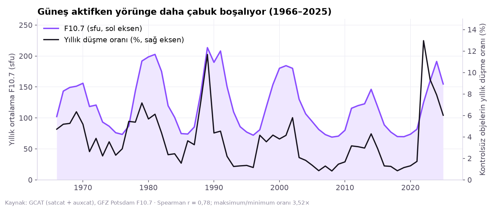
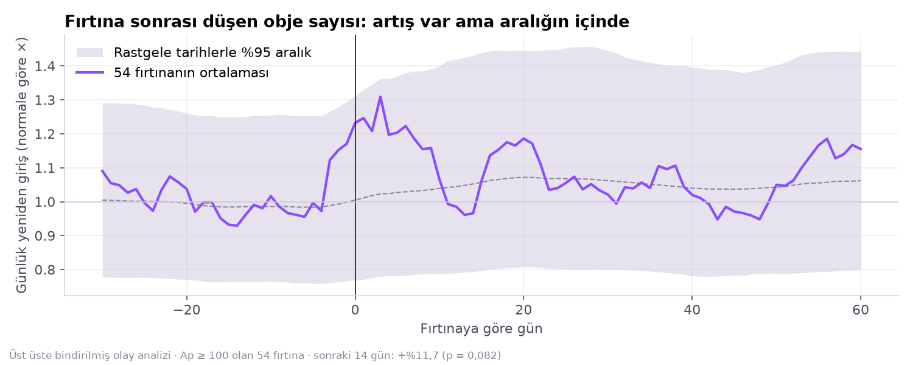
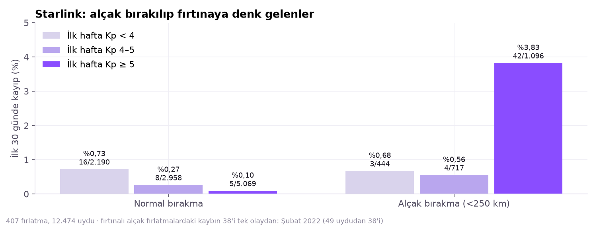
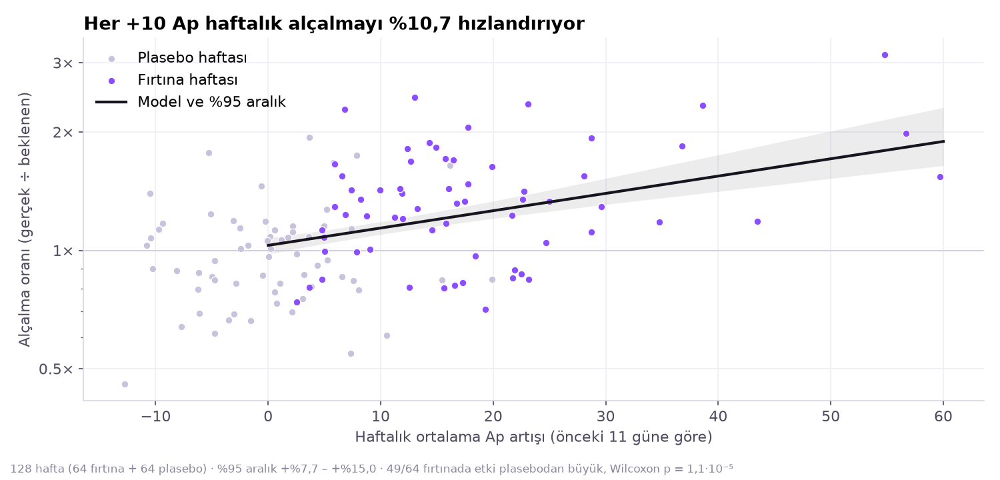
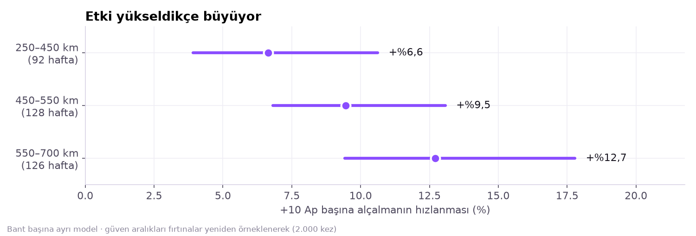
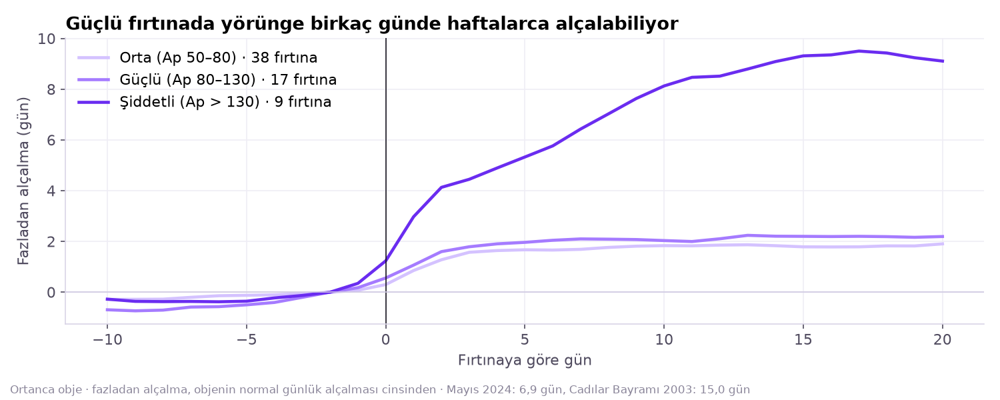

# Sonuçlar

Projedeki bütün sayısal sonuçlar, grafikleriyle birlikte. Her sayı `dash_data/` klasöründeki dosyalardan gelir; grafikler [`tools/make_figures.py`](../tools/make_figures.py) ile üretilir. Yöntemin ayrıntısı için [YONTEM.md](YONTEM.md).

## Özet

| # | Soru | Sonuç | Güven |
|---|---|---|---|
| A | Güneş döngüsü düşüşleri etkiliyor mu? | Maksimumda düşme oranı minimumun **3,52 katı** | Güçlü (r = 0,78, 60 yıl) |
| B | Tek fırtına daha çok objeyi düşürüyor mu? | Sonraki 14 günde **+%11,7** | Zayıf (p = 0,082) |
| C | Starlink kayıpları fırtınayla ilgili mi? | Alçak bırakmada fırtınalı hafta **%3,83**, sakin **%0,60** | Tek olaya dayalı |
| D | Fırtına yörüngeleri alçaltıyor mu? | Her **+10 Ap** alçalmayı **%10,7** hızlandırıyor | Güçlü (49/64, p = 1,1·10⁻⁵) |
| D | İrtifaya göre değişiyor mu? | 250–450 km'de %6,6 → 550–700 km'de %12,7 | Tutarlı doz-yanıt |

---

## A · Güneş döngüsü

| Ölçü | Değer |
|---|---|
| Yeniden giriş (kontrolsüz, 1965–2026) | 35.231 |
| Pearson r (F10.7 ~ düşme oranı) | 0,671 |
| Spearman r | 0,783 |
| F10.7 %10'luk dilim (minimum) | 73 sfu |
| F10.7 %90'lık dilim (maksimum) | 190 sfu |
| Maksimum / minimum düşme oranı | **3,52×** |
| En yüksek yıllık oran | 2022 (%13,0) |
| En düşük yıllık oran | 2008 (%0,8) |
| En yüksek yıllık F10.7 | 1989 (214 sfu) |

**Yorum:** Güneş ultraviyole ışınımı termosferi ısıtıp genişletir; alçak yörüngedeki hava yoğunluğu artar, objeler daha hızlı düşer. 60 yıl ve beş Güneş döngüsü boyunca ilişki çok tutarlı.

---

## B · Fırtına sonrası düşen obje sayısı

| Ölçü | Değer |
|---|---|
| Fırtına (Ap ≥ 100, 30 gün ayrık) | 54 |
| Sonraki 14 günde fazla düşüş | **+%11,7** |
| %95 güven aralığı | −%2,1 – +%27,2 |
| p (rastgele tarih testi, 2.000 tekrar) | 0,082 |
| Günlük zirve | +3. gün, 1,31× (rastgele aralığın üst sınırı 1,36×) |

### Fırtına gücüne göre

| Ap sınıfı | Fırtına | Fazla | %95 aralık | p |
|---|---|---|---|---|
| 30–50 | 82 | +%3,1 | −%9,4 – +%16,5 | 0,346 |
| 50–80 | 88 | −%1,9 | −%10,9 – +%8,1 | 0,612 |
| 80–120 | 57 | +%10,4 | −%2,4 – +%26,4 | 0,108 |
| 120+ | 34 | +%9,6 | −%5,5 – +%27,9 | 0,104 |

### 1932'den bu yana en güçlü 10 fırtına günü

| Tarih | Ap | Kp | 14 günde düşen | Beklenen |
|---|---|---|---|---|
| 2024-05-11 | 271 | 9,0 | 53 | 50,4 |
| 1989-03-13 | 246 | 9,0 | 75 | 57,9 |
| 2003-10-29 | 204 | 9,0 | 33 | 22,9 |
| 1986-02-08 | 202 | 9,0 | 21 | 29,4 |
| 1982-09-06 | 199 | 8,7 | 28 | 28,0 |
| 1991-06-05 | 196 | 8,7 | 18 | 17,3 |
| 2001-03-31 | 192 | 8,7 | 23 | 25,7 |
| 2004-07-27 | 186 | 8,7 | 5 | 7,0 |
| 1972-08-05 | 182 | 8,7 | 14 | 18,2 |
| 1992-05-10 | 179 | 8,7 | 25 | 10,3 |

**Yorum:** Yön tutarlı (güçlü fırtınalarda +%10 civarı) ama hiçbir aralık sıfırı dışlamıyor. Nedeni D bölümünde: bir fırtına objelerin düşüşünü birkaç gün ya da hafta öne çeker. Yıllar süren bir alçalmanın yanında bu, sayım verisinde gürültünün içinde kalır. Etkiyi görmek için düşüş sayısına değil, doğrudan irtifaya bakmak gerekir.

---

## C · Starlink

| Bırakma | İlk hafta | Fırlatma | Uydu | 30 günde kayıp | Oran |
|---|---|---|---|---|---|
| Normal | Kp < 4 | 67 | 2.190 | 16 | %0,73 |
| Normal | Kp 4–5 | 103 | 2.958 | 8 | %0,27 |
| Normal | Kp ≥ 5 | 181 | 5.069 | 5 | %0,10 |
| Alçak (< 250 km) | Kp < 4 | 10 | 444 | 3 | %0,68 |
| Alçak (< 250 km) | Kp 4–5 | 17 | 717 | 4 | %0,56 |
| Alçak (< 250 km) | Kp ≥ 5 | 29 | 1.096 | 42 | **%3,83** |

| Ölçü | Değer |
|---|---|
| İncelenen | 407 fırlatma, 12.474 uydu |
| Alçak bırakma, fırtınalı vs sakin | %3,83 (42/1.096) vs %0,60 (7/1.161) |
| Fisher kesin testi | p = 5,6·10⁻⁸, olasılık oranı 6,6 |
| Şubat 2022 çıkarılınca (fırtınalı) | %0,38 (4/1.047) |
| Şubat 2022 (`2022-010`) | 49 uydudan 38'i, bırakma ≈ 209 km, ilk hafta Kp 5,3 |

**Yorum:** Fark istatistiksel olarak çok belirgin görünse de 42 kaybın 38'i tek fırlatmadan geliyor. O fırlatma çıkarıldığında fırtınalı grubun kaybı sakin grubunkinden düşük. Şubat 2022 gerçek ve ciddi bir olay, ama "fırtına alçak bırakılan Starlink'leri düzenli olarak düşürüyor" demek için veri yetersiz. Kayıp, fırtınanın şiddetinden çok zamanlamasından kaynaklandı: uydular 209 km'de, yükselmeye başlamadan önce küçük ölçekli (G1) bir fırtınaya yakalandı.

---

## D · Fırtına haftasında yörünge alçalması

### Fırtına ve plasebo haftaları

| Ölçü | Değer |
|---|---|
| Obje-fırtına ölçümü | 10.695 |
| Fırtına | 64 (2000–2026) |
| Pencere | 128 (64 fırtına + 64 plasebo) |
| Ortanca oran, fırtına haftası | **1,30×** |
| Ortanca oran, plasebo haftası | 0,95× |
| Fırtına > plasebo | **49 / 64** |
| Wilcoxon eşleştirilmiş test | p = 1,1·10⁻⁵ |

### Model katsayıları

| Bant | Pencere | Fırtına | R² | +10 Ap | %95 aralık | +10 sfu F10.7 | %95 aralık |
|---|---|---|---|---|---|---|---|
| Tümü | 128 | 64 | 0,419 | **+%10,7** | +%7,7 – +%15,0 | +%6,4 | +%4,0 – +%9,3 |
| 250–450 km | 92 | 46 | 0,367 | +%6,6 | +%3,9 – +%10,6 | +%4,9 | +%2,9 – +%7,6 |
| 450–550 km | 128 | 64 | 0,428 | +%9,5 | +%6,8 – +%13,1 | +%6,4 | +%4,3 – +%8,7 |
| 550–700 km | 126 | 64 | 0,408 | **+%12,7** | +%9,4 – +%17,8 | +%6,8 | +%3,7 – +%9,9 |

**Yorum:** Etki yükseldikçe büyüyor. Termosferde yoğunluk yükseklikle üstel azalır; fırtına atmosferi ısıttığında ölçek yüksekliği uzar ve yoğunluk üst katmanlarda oransal olarak daha çok artar. Bu, bilinen fizikle uyumlu bağımsız bir doğrulama.

### Gün gün fazladan alçalma

### En etkili fırtınalar

| Fırtına | Ap tepe | ΔAp | ΔF10.7 | Obje | Oran | Plasebo | Kayıp gün |
|---|---|---|---|---|---|---|---|
| 2003-10-29 (Cadılar Bayramı) | 204 | +54,8 | +89,5 | 145 | **3,15×** | 0,85× | **15,0** |
| 2001-03-31 | 192 | +23,1 | +44,4 | 145 | 2,36× | 1,09× | 9,5 |
| 2000-07-15 | 164 | +38,6 | +30,3 | 101 | 2,34× | 0,86× | 9,4 |
| 2024-05-11 (Mayıs 2024) | 271 | +56,7 | +58,9 | 263 | 1,98× | 0,94× | 6,9 |
| 2026-01-20 | 144 | +36,8 | +58,0 | 227 | 1,84× | 1,01× | 5,9 |
| 2024-08-12 | 127 | +14,9 | −16,1 | 295 | 1,83× | 0,80× | 5,8 |
| 2004-07-27 | 186 | +43,5 | −46,1 | 114 | 1,18× | 1,15× | 1,3 |

64 fırtınanın tam listesi `dash_data/alt_events.json` dosyasında ve canlı sunumun Bilgi panelindeki **Fırtına arşivi** tablosunda.

**Yorum:** Mayıs 2024 Ap bakımından en güçlüsü olsa da en büyük yörünge kaybı Cadılar Bayramı 2003'te: o hafta Güneş ışınımı (F10.7) da çok yükselmişti. Temmuz 2004 ise yüksek Ap'ye rağmen zayıf ışınımla küçük bir etki bıraktı. İki değişkenin birlikte önemli olduğunu model de gösteriyor.

---

## Üç analiz birlikte

1. **Güneş döngüsü** yörüngedeki obje nüfusunu yıllar ölçeğinde güçlü biçimde düzenliyor.
2. **Tek bir fırtına** yörüngeleri ölçülebilir biçimde alçaltıyor, ama düşüşü yalnızca birkaç gün ya da hafta öne çektiği için yeniden giriş sayılarında kesin bir iz bırakmıyor.
3. **Fırlatmadan hemen sonraki alçak yörünge** en savunmasız an: Şubat 2022'de küçük bir fırtına 38 uyduyu düşürmeye yetti.
