# Etkileşimli sunum

**Canlı:** https://storm-and-orbit.up.railway.app

Analizin sonuçlarını anlatan, tarayıcıda çalışan bir 3B sunum. Tek bir HTML dosyası; derleme aracı, çerçeve ya da sunucu tarafı kod yok.

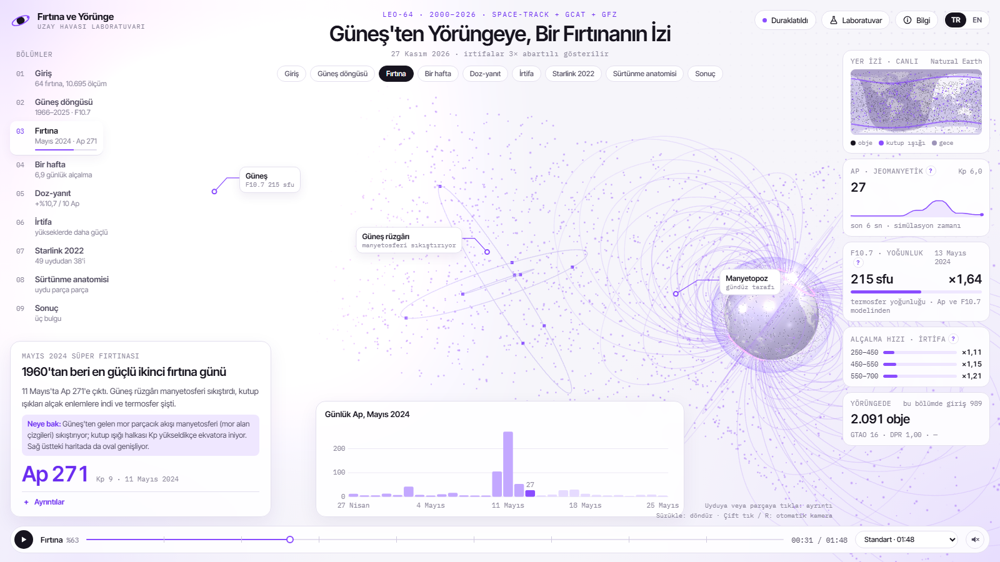

## İçindekiler

- [Bölümler](#bölümler)
- [Özellikler](#özellikler)
- [Kullanım](#kullanım)
- [Mimari](#mimari)
- [Görüntü işleme](#görüntü-işleme)
- [Ses](#ses)
- [Erişilebilirlik ve performans](#erişilebilirlik-ve-performans)
- [Geliştirme](#geliştirme)
- [Ekran görüntüleri](#ekran-görüntüleri)

## Bölümler

Sunum 9 bölümden oluşur; her bölüm simülasyon zamanında 12 saniyedir.

| # | Bölüm | Sahne | Veri paneli |
|---|---|---|---|
| 1 | Giriş | Dünya, termosfer kabuğu, 2.400 temsilî obje, kutup ışıkları | — |
| 2 | Güneş döngüsü | 1966–2025 boyunca yıl yıl F10.7; kabuk Güneş'le şişip daralıyor | Yıllık F10.7 ve düşme oranı |
| 3 | Fırtına | Mayıs 2024: Güneş rüzgârı, sıkışan manyetosfer, genişleyen kutup ışığı ovali | Günlük Ap çubukları |
| 4 | Bir hafta | Kamera tek bir objeyi izler; fırtına haftasında yörüngesi hızla alçalır | Fırtına gücüne göre kayıp gün eğrileri |
| 5 | Doz-yanıt | 128 hafta tek tek beliriyor | Ap artışı × alçalma oranı, model bandı seçilebilir |
| 6 | İrtifa | Üç irtifa kabuğu sırayla parlıyor | Bant katsayıları ve aralıkları |
| 7 | Starlink 2022 | 49 uydu 209 km'de; 38'i atmosfere giriyor, 11'i yükseliyor | Kayıp oranları |
| 8 | Sürtünme anatomisi | Stüdyo: uydu 39 parçaya ayrılıyor | — |
| 9 | Sonuç | Uydu yeniden birleşip iyon iticisiyle ayrılıyor; üç bulgu | — |

## Özellikler

### Açılış ekranı

- Altı adımlı yükleme ilerlemesi: kütüphane, veri, Dünya, uydu, harita, gölgelendiriciler.
- Dil (Türkçe / English) ve süre seçimi; **Sesli başlat** ve **Sessiz başlat**.
- Harita 12 saniyede yüklenmezse sunum prosedürel kıtalarla açılır.

### Süre seçenekleri

| Seçenek | Hız | Toplam |
|---|---|---|
| Hızlı | 1,5× | 01:12 |
| Standart | 1× | 01:48 |
| Ayrıntılı | 0,5× | 03:36 |
| Sunum | ⅓× | 05:24 |
| Elle | 0,5×, her bölüm sonunda durur | — |

Seçim tarayıcıda hatırlanır. Müzik, seçilen hıza göre yeniden düzenlenir.

### Anlatı kartı

Her bölümde başlık, kısa açıklama, büyük bir sayı ve:

- **Neye bak:** o anda 3B sahnede ve grafikte neye dikkat edileceği.
- **Ayrıntılar:** veriden hesaplanan 4–8 ek bilgi.
- **Bilgi panelinde:** ilgili bölüme bağlantı.

### Fırtına laboratuvarı

- Haftalık Ap artışı (0–120) ve F10.7 değişimi (−50…+120 sfu) kaydırıcıları.
- Üç irtifa bandı için modelin tahmini: oran ve haftada kaç günlük fazladan alçalma.
- Hazır ayarlar: sakin hafta, Şubat 2022, Mayıs 2024, Cadılar Bayramı 2003. Her biri modelin tahminini o hafta ölçülen değerle yan yana gösterir.
- Ölçülen aralığın dışına çıkıldığında uyarı.
- Küre, kutup ışıkları, manyetosfer ve telemetri seçilen değerlere göre değişir.

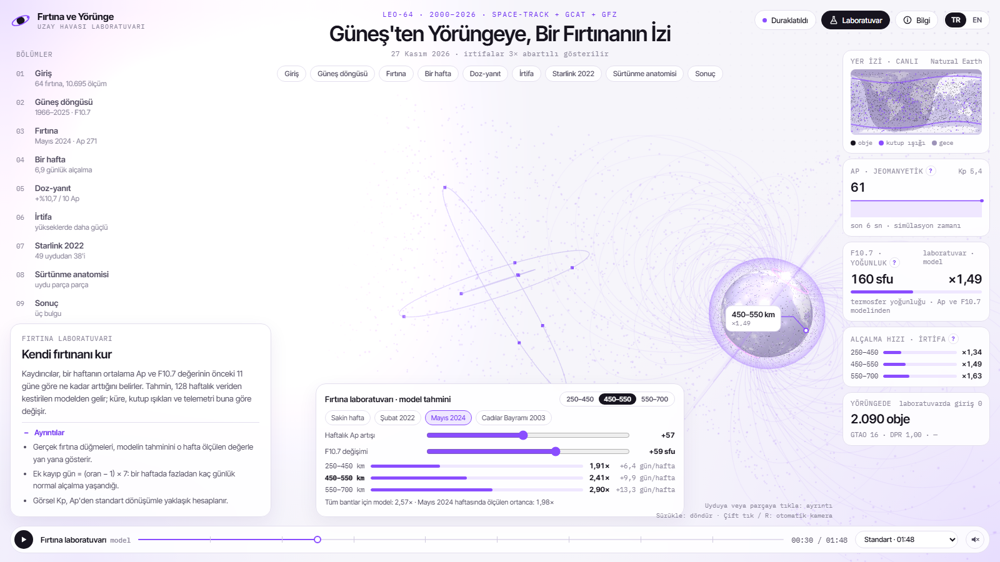

### Tıklayarak inceleme

- **Küredeki objeler:** irtifa, eğim, yörünge periyodu, enlem/boylam, durum ve modele göre alçalma hızı. Seçilen obje haritada da halkayla işaretlenir.
- **Uydu parçaları:** 14 parça türünün ne işe yaradığı ve kaçıncı parça olduğu.

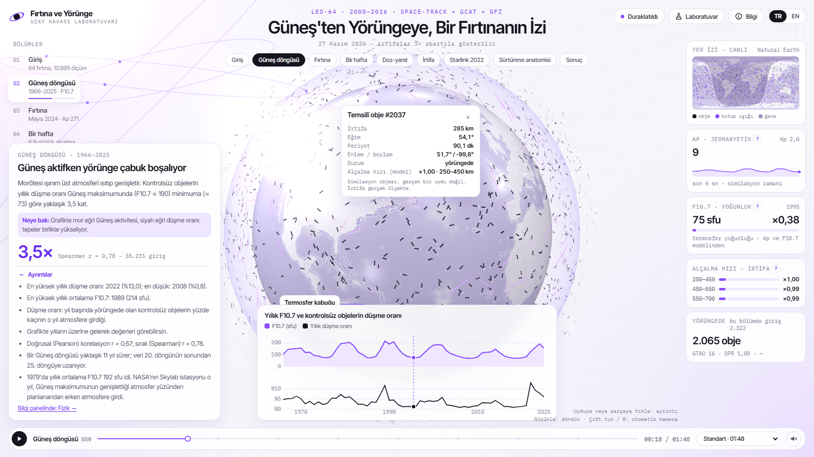

### Bilgi paneli

12 bölüm, üstte bölüm düğmeleri:

| Bölüm | İçerik |
|---|---|
| Özet | Dört ana bulgu |
| Terimler | LEO, termosfer, F10.7, Ap, Kp, plasebo, kayıp gün, doz-yanıt, sürtünme, B* |
| Fırtına arşivi | 64 fırtınanın sıralanabilir tablosu; satıra tıklayınca laboratuvarda açılır |
| Fırtına sonrası düşüşler | Ap sınıflarına göre fazla düşüş ve 1932'den beri en güçlü 10 gün |
| Starlink | Bırakma irtifası × ilk hafta Kp tablosu |
| Fizik | CME'den yörüngeye beş adım, formüller, irtifaya göre hız ve periyot tablosu |
| NOAA ölçeği | G1–G5 ve veride yılda kaç gün görüldükleri |
| Tarihteki fırtınalar | Carrington 1859'dan Mayıs 2024'e zaman çizelgesi |
| Yöntem | Seçim, ölçüm, plasebo, model ve sınırlar |
| Sık sorulanlar | Beş soru |
| Kaynaklar | Veri kaynaklarına bağlantılar |
| Kısayollar | Klavye ve fare |

Telemetrideki **?** düğmeleri ilgili terimi açar.

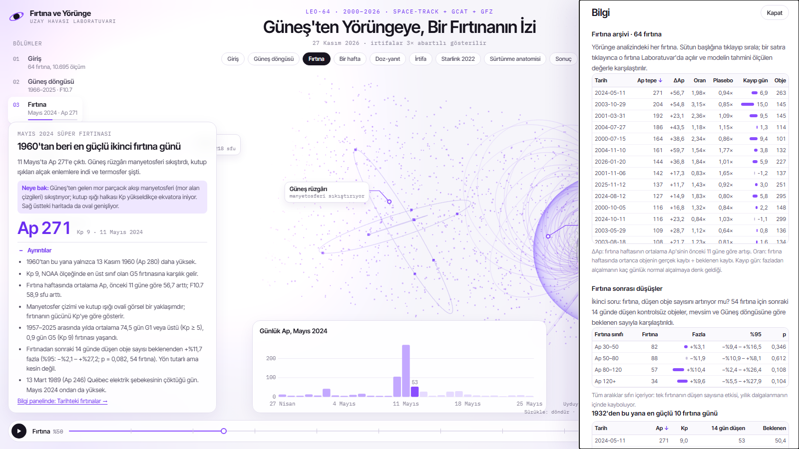

### Canlı telemetri ve harita

- **Yer izi haritası:** Natural Earth kıyı çizgileri, gece tarafı, iki kutup ışığı ovali ve bütün objelerin anlık konumu.
- **Ap ve Kp:** son 6 saniyenin çizgi grafiği.
- **F10.7 ve yoğunluk:** modelden termosfer yoğunluğu çarpanı.
- **Alçalma hızı:** üç irtifa bandı için anlık çarpan.
- **Yörüngede:** obje sayısı ve o bölümde atmosfere girenler.

### Grafiklerde üzerine gelme

Güneş döngüsü (yıl), Mayıs 2024 (gün), kayıp gün eğrileri (gün), doz-yanıt (hafta) ve irtifa (bant) grafiklerinin üzerine gelince değerler görünür.

## Kullanım

| Girdi | İşlev |
|---|---|
| Boşluk | Oynat / duraklat (elle modunda: sonraki bölüm) |
| ← → | Önceki / sonraki bölüm |
| L | Laboratuvar |
| I | Bilgi paneli |
| R ya da çift tık | Otomatik kameraya dön |
| Esc | Açık paneli kapat |
| Sürükle | Kamerayı döndür |
| Tekerlek | Yakınlaş / uzaklaş |
| Tık | Obje ya da parça seç |
| Zaman çizelgesi | Tıkla ya da sürükle; ← → ile 2 saniye |

**Adres parçaları:** `#en` İngilizce açar, `#firtina`, `#starlink` gibi bölüm adları o bölümden başlatır, `#capture` açılış ekranını atlar ve oynatmayı durdurur (ekran görüntüsü için).

**Betik arayüzü (`window.SIM`):** `seek(t)`, `play()`, `pause()`, `lang("en")`, `lab(true)`, `setDuration("talk")`, `pick(x, y)`, `capture(true)`, `state(t)`, `mapReady()`.

## Mimari

```
presentation/
├── template.html     ← bütün sunum (CSS + HTML + JavaScript modülü)
├── build_data.py     ← dash_data/*.json → gömülü window.DATA
├── index.html        ← derlenmiş sunum (artifact gövdesi)
├── preview.html      ← yerel test için tam HTML belgesi (depoda yok)
└── geo/              ← Natural Earth TopoJSON
deploy/
├── build_site.py     ← index.html → site/index.html (doctype, meta, simge) + geo
├── Dockerfile        ← caddy:2-alpine
├── Caddyfile         ← $PORT, sıkıştırma, önbellek başlıkları
└── site/             ← yayınlanan statik site
```

### Saf zaman fonksiyonu

Sahnenin her durumu tek bir fonksiyondan gelir: `stateAt(t)`. Aynı `t` her zaman aynı kareyi verir; hiçbir şey kare kare birikmez. Bu sayede:

- zaman çizelgesinde istenen noktaya anında atlanabilir,
- hız değiştirmek yalnızca zamanın ilerleme hızını değiştirir,
- ekran görüntüleri tekrarlanabilir.

Objelerin alçalması gibi birikimli büyüklükler için sürtünme hızının integrali önceden 1/30 saniyelik adımlarla hesaplanıp tabloya yazılır (`GTAB`); her kare bu tablodan ara değerle okunur.

### Veri akışı

1. `analysis.py` ve `altitude.py` → `dash_data/*.json`
2. `build_data.py` → sunuma özel ~34 KB özet → `template.html` içindeki yer tutucuya gömülür → `index.html`
3. `build_site.py` → tam HTML belgesi → `deploy/site/`
4. Railway → Caddy ile statik yayın

Sunumdaki bütün sayılar bu özetten hesaplanır; elle yazılmış sonuç yoktur. Yalnızca Şubat 2022 sabitleri ayrıca yazılıdır ve derleme sırasında veriyle doğrulanır.

## Görüntü işleme

- **three.js r170**, CDN'den import map ile.
- **Son işleme:** EffectComposer (HalfFloat, 4× MSAA) → GTAO ortam gölgelemesi → UnrealBloom (eşik 1,5; yalnızca parlak çizgiler ve kutup ışıkları) → OutputPass.
- **Aydınlatma:** RoomEnvironment PMREM ortam haritası, yarım küre ışığı, ana / dolgu / kenar yönlü ışıklar; tek, bilinçli aydınlık görünüm.
- **Dünya:** Natural Earth kara poligonları ve ülke sınırları 4096×2048 tuvale çizilir; ayrı bir pürüzlülük haritası okyanusu parlak, karayı mat yapar. Gölgelendiriciye eklenen gürültüyle kabartma ve kıta sahanlığı.
- **Bulutlar:** ayrı bir küre üzerinde, enleme göre yoğunlaşan, zamanla akan gürültü.
- **Termosfer:** Fresnel kenar parlaması; Güneş tarafında fırtınayla şişen kabuk.
- **Manyetosfer:** 84 alan çizgisi; Güneş rüzgârı tarafında sıkışma, gece tarafında uzama.
- **Kutup ışıkları:** manyetik kutba göre konumlanmış iki halka; Kp yükseldikçe ekvatora iner.
- **Objeler:** 2.400 obje, gövde ve güneş paneli olarak iki InstancedMesh; matrisler CPU'da her kare yazılır. Atmosfere girenler için 260 parlak iz.
- **Uydu modeli:** 39 parça, 1.143 bileşen. Gölgelendiriciye eklenen kenar dikişi, perçin sıraları ve havalandırma delikleri; dişliler, ısı emiciler, faz dizili anten elemanları, güneş hücreleri tek tek modellenmiştir.
- **Kalite yöneticisi:** kare hızı düşerse sırasıyla GTAO örnekleri, piksel oranı ve GTAO azaltılır.

## Ses

Bütün ses tarayıcıda sentezlenir; hiçbir ses dosyası yoktur.

- **Zincir:** enstrümanlar → (pad yolu kick ile sidechain) → alçak raf EQ +2 dB → yüksek raf +1,5 dB → kompresör → limitleyici; ayrıca 3,6 saniyelik stereo yankı ve ping-pong eko.
- **Armoni:** re minör; her bölüm dört akor, sonda Re majöre çözülür.
- **Enstrümanlar:** detune edilmiş pad + sub, FM elektrik piyano ve çan, arpej, doymuş bas, kick, snare, hi-hat.
- **Bölüm düzenlemeleri:** girişte yalnızca pad ve çan; fırtınada tam ritim; söküm bölümünde servo motor sesleri ve metalik tıkırtılar.
- **Veri sesi:** doz-yanıt bölümünde 128 haftanın her biri, alçalma oranına göre pentatonik bir nota olarak çalınır.
- **Zamanlama:** olaylar simülasyon zamanında tanımlanır ve seçilen hıza göre gerçek zamana çevrilir; atlama ya da hız değişiminde yeniden planlanır.

## Erişilebilirlik ve performans

- Bütün düğmeler klavyeyle kullanılabilir ve görünür odak halkası taşır; zaman çizelgesi `role="slider"`.
- `prefers-reduced-motion` açıksa sunum duraklatılmış başlar ve animasyonlar kapanır.
- Anlatı kartı `aria-live` ile okunur.
- Dar ekranlarda (≤ 760 px) telemetri yatay kaydırılır, grafikler gizlenir, laboratuvar alttan açılır.
- Sayfa ~270 KB (gömülü veri dahil); harita dosyaları toplam ~0,7 MB.

## Geliştirme

```powershell
python presentation\build_data.py
python -m http.server 8791 --directory presentation
```

`http://localhost:8791/preview.html` adresini açın. `template.html` değiştikten sonra `build_data.py` yeniden çalıştırılmalıdır.

**Ekran görüntülerini yenilemek:**

```powershell
cd tools\screenshots
npm install
node shoot.mjs
```

Edge ya da Chrome gerekir; görüntüler `docs/screenshots/` klasörüne yazılır. Varsayılan adres canlı sitedir; yerel bir adres argüman olarak verilebilir.

## Ekran görüntüleri

| | |
|---|---|
| 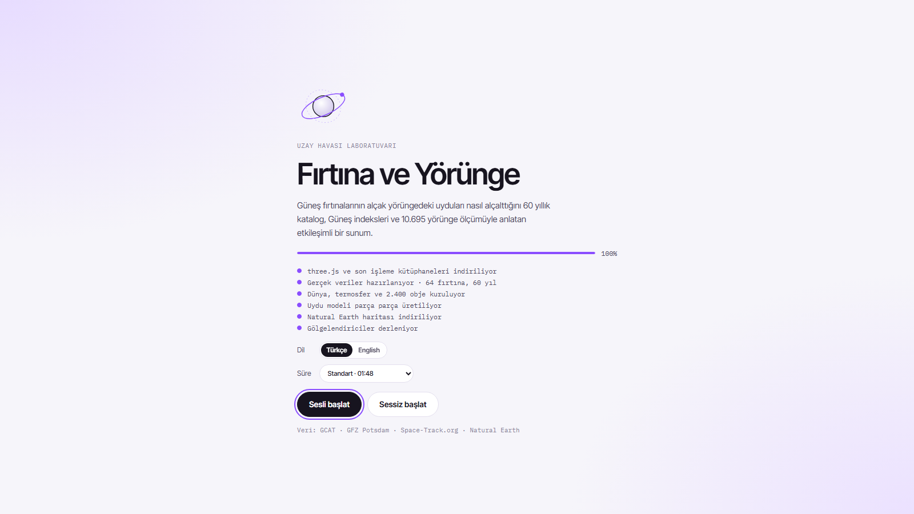 Açılış ekranı | 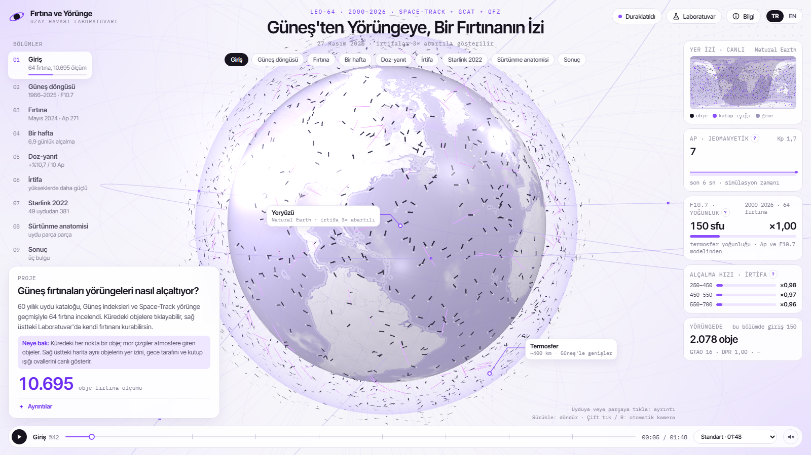 Giriş |
| 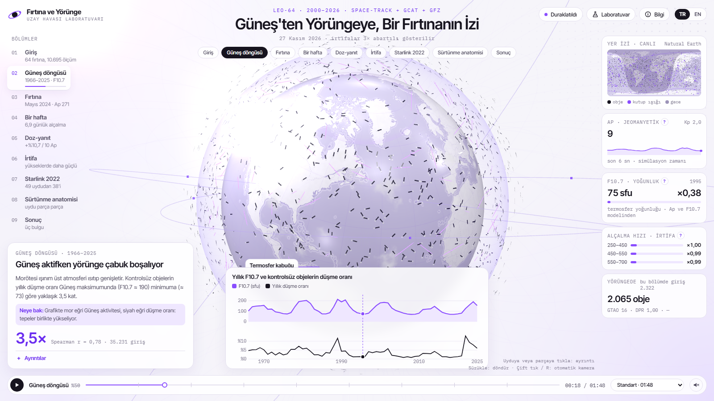 Güneş döngüsü |  Fırtına |
| 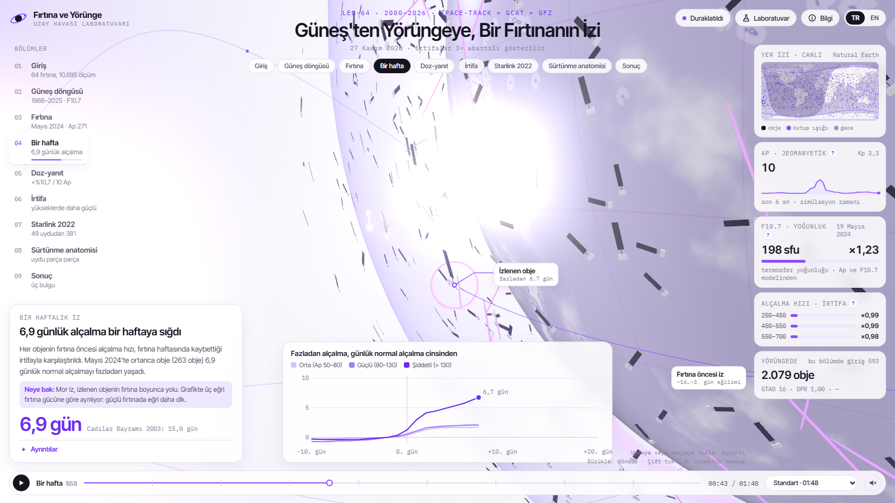 Bir hafta | 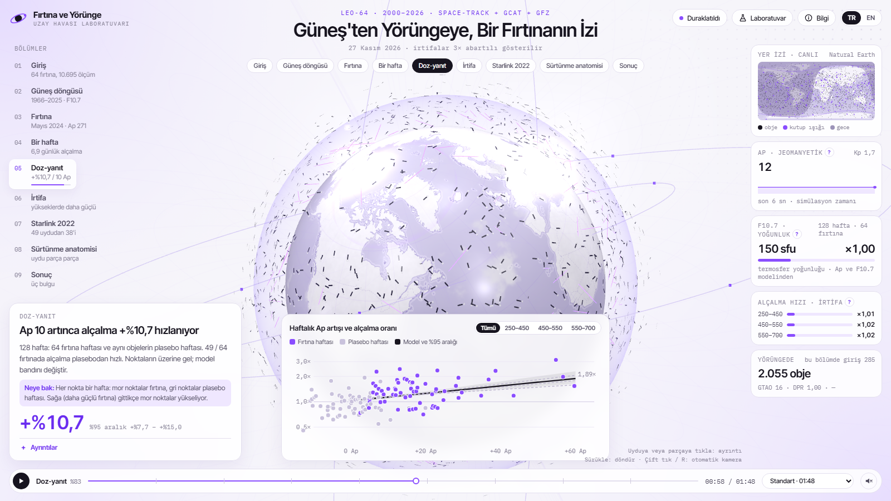 Doz-yanıt |
| 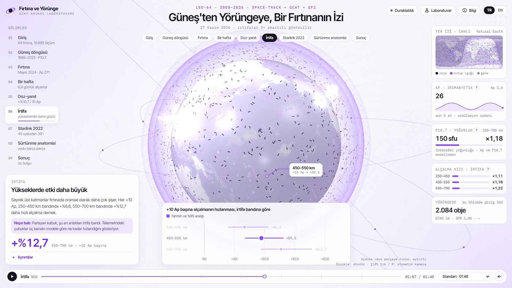 İrtifa | 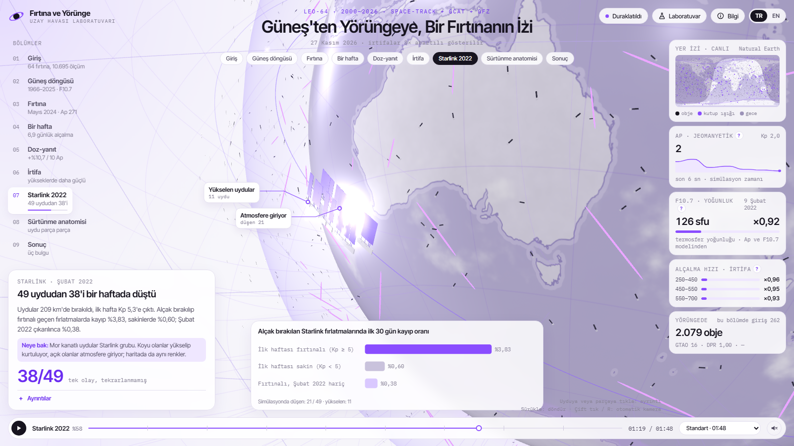 Starlink 2022 |
| 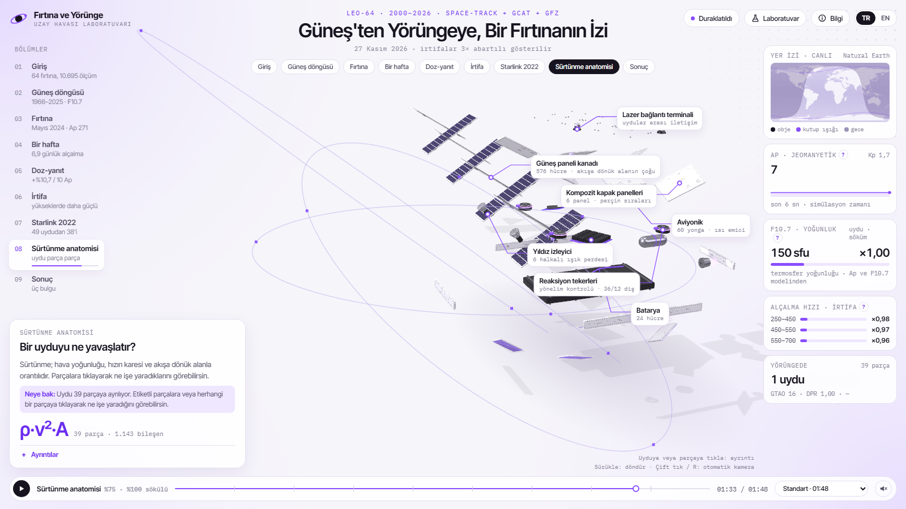 Sürtünme anatomisi | 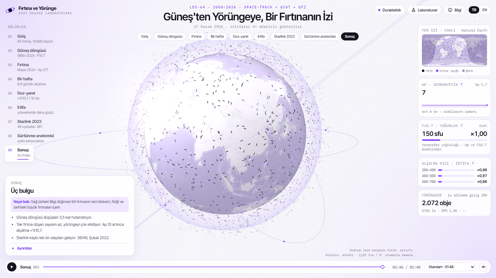 Sonuç |
| 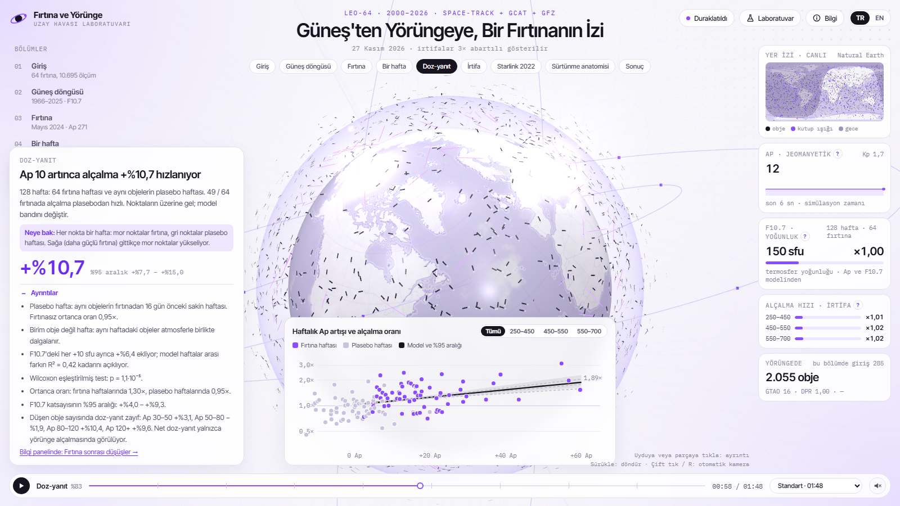 Ayrıntılar açık |  Laboratuvar |
|  Fırtına arşivi | 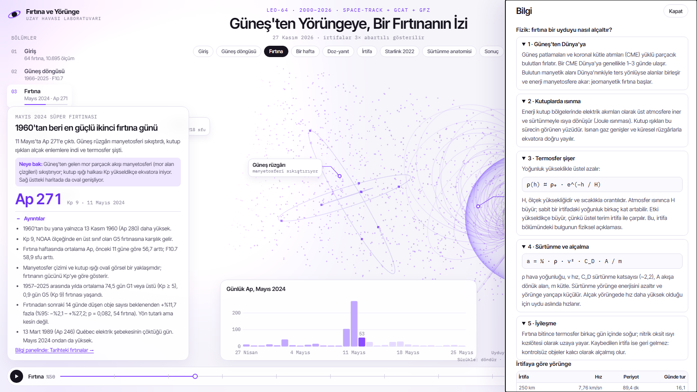 Fizik |
|  Obje seçimi | 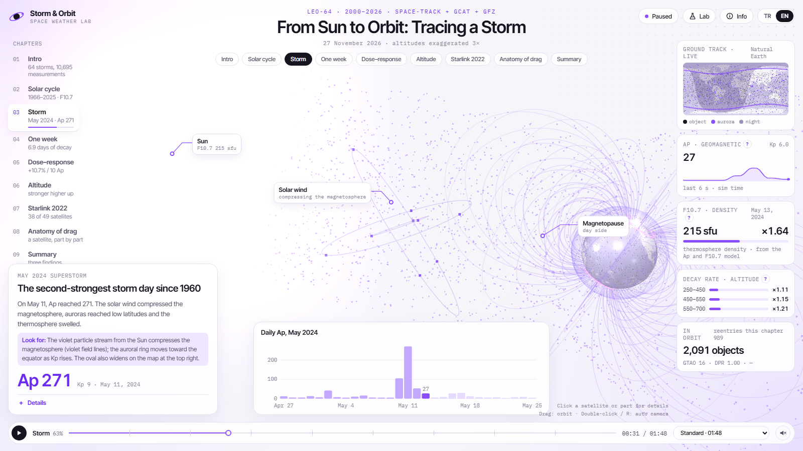 English |
| 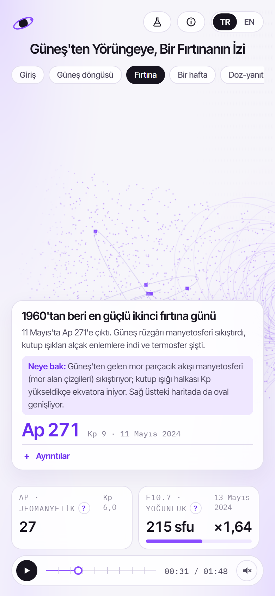 Mobil | |
